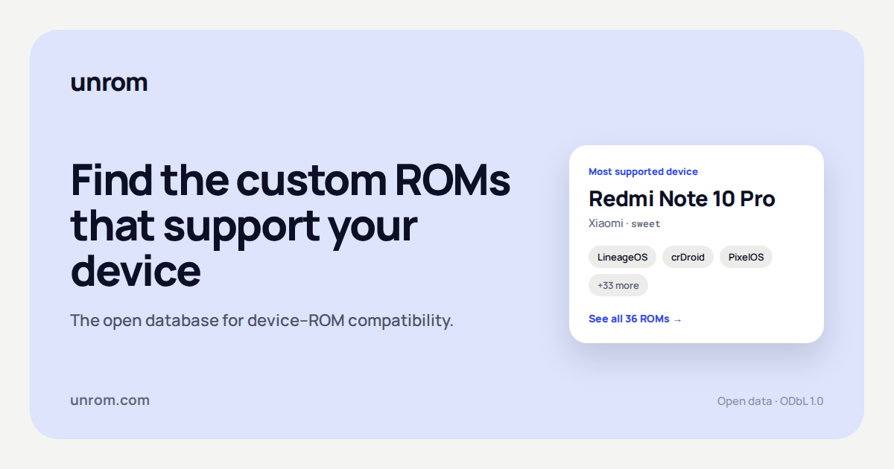

# unrom

Find the custom Android ROMs that run on your device.

unrom is a searchable index of 9,000+ devices and 270+ custom ROMs, and every
mapping links the page it came from, so an answer can be checked. The data
itself is open: JSON, SQLite and an API.

## Documentation

- **Site**: https://unrom.com
- **Data, exports and the API**: https://unrom.com/data
- **Pipeline, schema and endpoints**: [server/README.md](./server/README.md)
- **Coverage, sources and backlog**: [DATASET.md](./DATASET.md)
- **Self-hosting, refreshing and deploying**: [SELF_HOSTING.md](./SELF_HOSTING.md)

## Contributing

Read the [contributing guide](./CONTRIBUTING.md) before you send a change. It
covers the sign-off and the licence terms.

## License

- **Code**: AGPL-3.0-only ([`LICENSE`](./LICENSE)).
- **Data & exports**: ODbL-1.0 ([`DATA_LICENSE`](./DATA_LICENSE)); upstream ROM
  data keeps its own terms. See [`ATTRIBUTION.md`](./ATTRIBUTION.md).
- **Trademarks**: Android is a trademark of Google LLC. All other product names,
  logos, and brands are property of their respective owners and are used for
  identification purposes only. unrom is not affiliated with or endorsed by any
  of them.
